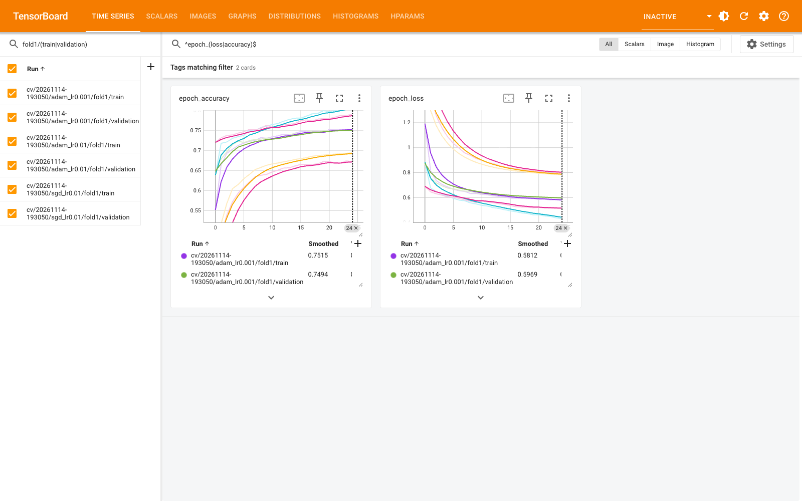
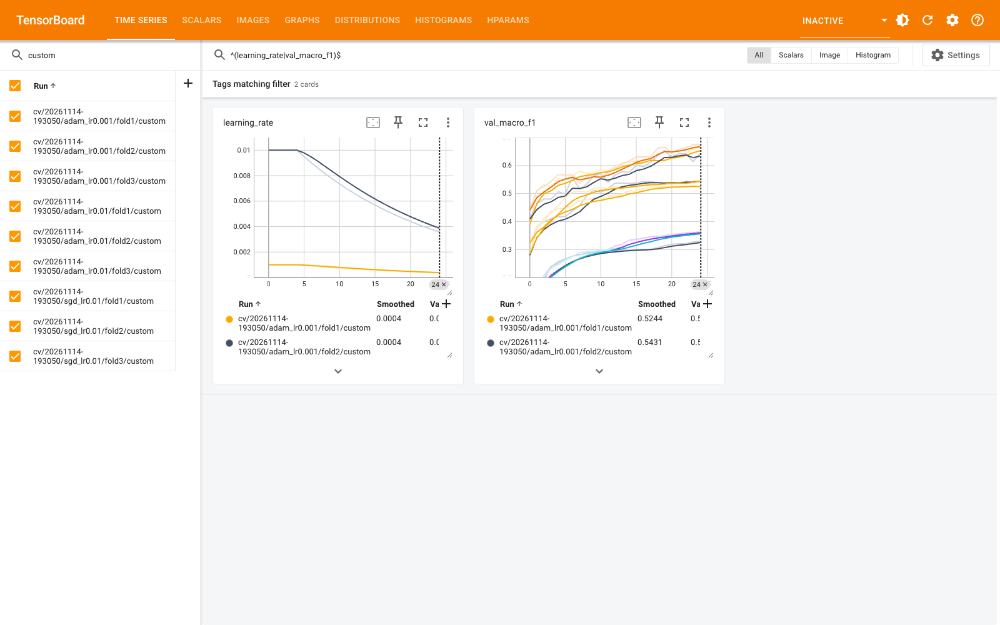
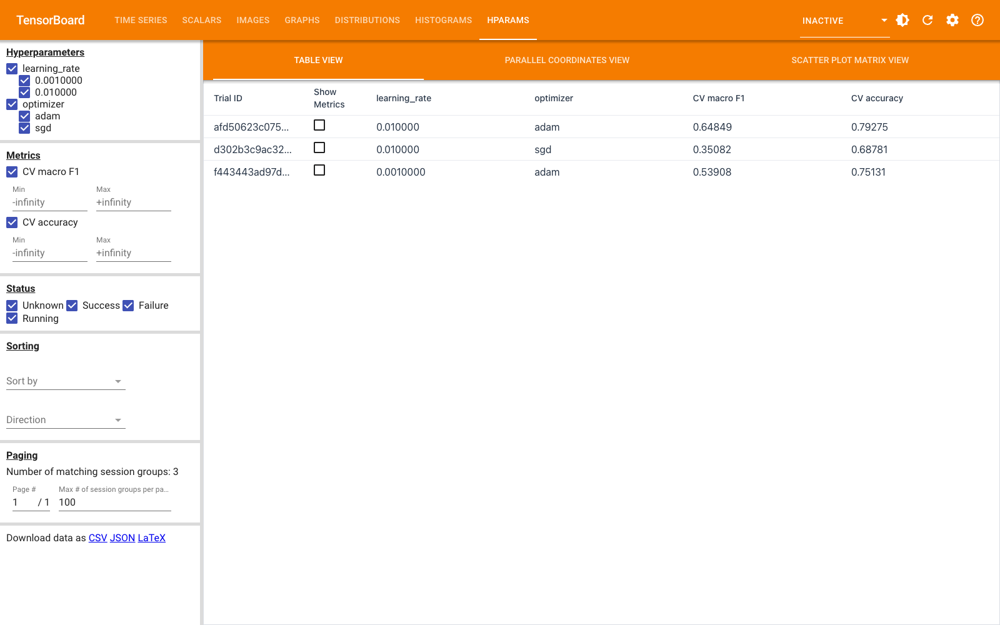
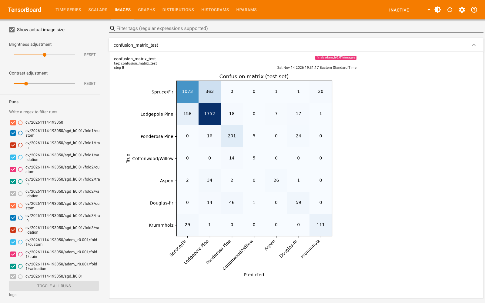

# Lab 4: TensorBoard (modified)

Karuniya Premnath, IE 7374 MLOps


This lab is based on `Labs/Tensorflow_Labs/TensorBoard/Lab1.ipynb` from [raminmohammadi/MLOps](https://github.com/raminmohammadi/MLOps).
The original trains a one-layer model on 1,000 made-up points and shows the loss in TensorBoard.
I moved it to a real classification problem, compared three configs with cross-validation, and used six TensorBoard dashboards instead of one.

## Dataset

Forest Cover Type (UCI, loaded with `sklearn.datasets.fetch_covtype`). Each row is a 30m x 30m patch of forest in Colorado with 54 features (elevation, slope, distance to water and roads, sunlight, wilderness area, soil type). The task is to predict which of 7 tree types covers it.

I use a stratified sample of 20,000 rows so everything runs in about 10 minutes on Colab. The classes are very unbalanced (Cottonwood/Willow is under 1%), so the main metric is macro F1, not accuracy.

## My Modifications

| Area | Original lab | My version |
|---|---|---|
| Dataset | 1,000 made-up points (y = 0.5x + 2 + noise) | Forest Cover Type, 20,000 rows, 54 real features, 7 classes |
| Task | Regression | Multi-class classification |
| Model | Dense(16) then Dense(1), no activation | Dense(128, relu), Dropout(0.2), Dense(64, relu), Dense(7, softmax) |
| Training | One run, SGD with learning rate 0.2 | Three configs (SGD 0.01, Adam 0.001, Adam 0.01), each with 3-fold cross-validation |
| Model selection | None | Best config picked by mean CV macro F1. The test set is not used for picking |
| Evaluation | Printed average training loss labelled as "test loss" | Chosen model retrained on the full training set and tested once: macro F1, accuracy, per-class report |
| Callbacks | TensorBoard only | TensorBoard with weight histograms, learning rate schedule, early stopping, my own callback |
| Custom logging | None | Learning rate and validation macro F1 written with `tf.summary` every epoch |
| HParams | Not used | Optimizer and learning rate logged as hyperparameters, CV macro F1 and CV accuracy as metrics |
| Images | Not used | Test-set confusion matrix logged to the Images tab |
| Debugger | Turned on, but the model trains fine so there is nothing to see | Separate run on unscaled data with a high learning rate (0.5), so the loss goes to NaN and Debugger V2 shows alerts |
| Code structure | Everything in the notebook | Helper functions in `lab_utils.py` |
| Testing | None | 11 unit tests in `tests/`, run by GitHub Actions on every push and inside the notebook |

## How the best model is picked

1. 20% of the data is split off as the test set at the start and not used again until the last step.
2. Each config is trained with 3-fold cross-validation on the remaining 80%. The scaler is fit on each fold's training part only.
3. `select_best()` picks the config with the highest mean CV macro F1. It never sees test scores (there is a unit test that checks this).
4. That config is retrained on the full training set and evaluated on the test set once.

## How to run

1. Open `Lab4_TensorBoard.ipynb` in Google Colab.
2. Click Runtime > Run all. The first cell clones this repo to get `lab_utils.py` and the tests.
3. TensorBoard opens in the second-to-last cell. Debugger V2 opens in the last cell, in its own TensorBoard pointed at `logs/debugger`, because Debugger V2 only reads debugger data that sits directly in `--logdir`.

To run the tests locally:

```bash
pip install -r requirements.txt
pytest -v tests/
```

## Results

Numbers from my run (TensorFlow 2.21, seed 42). The notebook is saved with its outputs, so the same numbers are in sections 4 and 5.

**Cross-validation (3 folds, training set only)**

| Config | CV macro F1 (mean ± std) | CV accuracy |
|---|---|---|
| **Adam, lr 0.01** | **0.6485 ± 0.0255** | **0.7928** |
| Adam, lr 0.001 | 0.5391 ± 0.0115 | 0.7513 |
| SGD, lr 0.01 | 0.3508 ± 0.0150 | 0.6878 |

Adam with lr 0.01 was picked by CV macro F1 and retrained on the full training set for 24 epochs.

**Final test set (4,000 rows, used once)**

| Metric | Score |
|---|---|
| Macro F1 | 0.6577 |
| Accuracy | 0.8067 |

The test macro F1 (0.6577) is close to the CV estimate (0.6485), so the CV score was an honest guide. Accuracy (0.81) is much higher than macro F1 (0.66) because the rare classes are harder: Cottonwood/Willow has F1 0.33 (19 test rows) and Aspen 0.53, while Lodgepole Pine reaches 0.85.

**Scalars:** loss and accuracy for fold 1 of each config



**Custom scalars:** learning rate and validation macro F1



**Histograms:** weights and biases of each layer over epochs


**HParams:** CV scores of the three configs



**Images:** test-set confusion matrix



**Debugger V2:** the broken run (unscaled features, SGD lr 0.5) turns the loss into NaN in the first epoch. Debugger V2 flags 1000 NaN/∞ alerts, and the pink +∞ badges show the layer tensors where the values overflowed


## What I learned

- TensorBoard is more than a loss plot. Scalars, histograms, HParams, images and the debugger each answer a different question about a training run.
- Picking a model by its test score makes the test score look better than it really is. Cross-validation on the training data gives a fair way to choose, and the test set then gives an honest final number.
- Unscaled inputs plus a high learning rate can break training quickly. Debugger V2 shows where the NaN values start, which is much faster than guessing. With learning rate 0.1 the loss only spiked and then recovered, so I had to go to 0.5 before there was anything for the debugger to catch.
- On unbalanced data, accuracy can hide poor results on rare classes. Macro F1 and the confusion matrix show that problem.
- Moving helper code out of the notebook made it possible to unit test it and run those tests in CI.

## Files

- `Lab4_TensorBoard.ipynb` - the notebook (run in Colab)
- `lab_utils.py` - data, model, selection and plotting helpers
- `tests/test_lab_utils.py` - unit tests
- `requirements.txt` - Python packages
- `.github/workflows/tests.yml` - GitHub Actions workflow that runs the tests
- `screenshots/` - TensorBoard screenshots from my run (the numbers above come from the same run)
