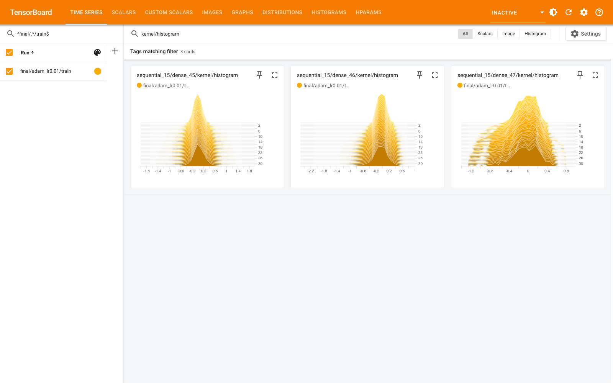
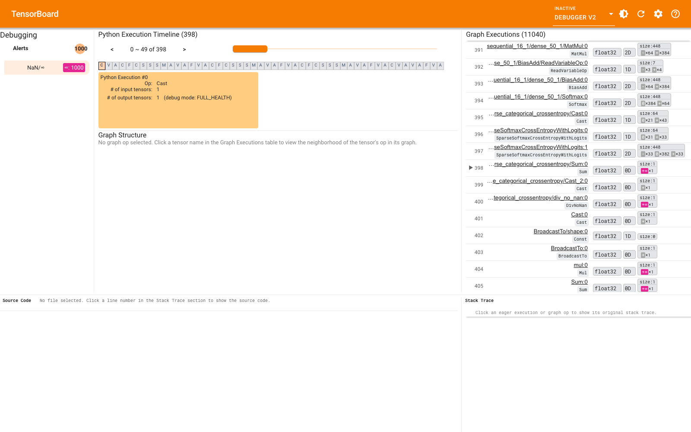

# Lab 4: TensorBoard (modified)

Karuniya Premnath, IE 7374 MLOps


[](https://colab.research.google.com/github/karunprem45/ml_tensorflow_lab4/blob/main/Lab4_TensorBoard.ipynb)

This lab is based on `Labs/Tensorflow_Labs/TensorBoard/Lab1.ipynb` from [raminmohammadi/MLOps](https://github.com/raminmohammadi/MLOps).
The original trains a one-layer model on 1,000 made-up points and shows the loss in TensorBoard.
I moved it to a real classification problem, compared five configs with cross-validation (optimizer, learning rate and class weights), and used seven TensorBoard dashboards instead of one.

## Dataset

Forest Cover Type (UCI, loaded with `sklearn.datasets.fetch_covtype`). Each row is a 30m x 30m patch of forest in Colorado with 54 features (elevation, slope, distance to water and roads, sunlight, wilderness area, soil type). The task is to predict which of 7 tree types covers it.

I use a stratified sample of 20,000 rows so everything runs in about 10 minutes on Colab. The classes are very unbalanced (Cottonwood/Willow is under 1%), so the main metric is macro F1, not accuracy.

## My Modifications

| Area | Original lab | My version |
|---|---|---|
| Dataset | 1,000 made-up points (y = 0.5x + 2 + noise) | Forest Cover Type, 20,000 rows, 54 real features, 7 classes |
| Task | Regression | Multi-class classification |
| Model | Dense(16) then Dense(1), no activation | Dense(128, relu), Dropout(0.2), Dense(64, relu), Dense(7, softmax) |
| Training | One run, SGD with learning rate 0.2 | Five configs, each with 3-fold cross-validation. Up to 100 epochs; early stopping (patience 5, min change 0.001) decides when each run ends |
| Class imbalance | Not relevant | Three class-weight settings compared on the same model: none, `sqrt` and `balanced` |
| Model selection | None | Best config picked by mean CV macro F1. The test set is not used for picking |
| Evaluation | Printed average training loss labelled as "test loss" | Chosen model retrained on the full training set and tested once: macro F1, accuracy, per-class report |
| Callbacks | TensorBoard only | TensorBoard with weight histograms, learning rate schedule, early stopping, my own callback |
| Custom Scalars | Not used | My own Custom Scalars layout (2 groups, 4 charts): train/validation loss, learning rate, validation macro F1, train/validation accuracy. The learning rate and validation macro F1 are written by my callback with `tf.summary` every epoch |
| HParams | Not used | Optimizer, learning rate and class weights logged as hyperparameters, CV macro F1 and CV accuracy as metrics |
| Images | Not used | Test-set confusion matrix logged to the Images tab |
| Debugger | Turned on, but the model trains fine so there is nothing to see | Separate run on unscaled data with a high learning rate (0.5), so the loss goes to NaN and Debugger V2 shows alerts |
| Code structure | Everything in the notebook | Helper functions in `lab_utils.py` |
| Testing | None | 16 unit tests in `tests/`, run by GitHub Actions on Python 3.11 and 3.13 and inside the notebook, plus a CI job that runs the whole notebook |

## How the best model is picked

1. 20% of the data is split off as the test set at the start and not used again until the last step.
2. Each config is trained with 3-fold cross-validation on the remaining 80%. The scaler and the class weights are computed from each fold's training part only.
3. `select_best()` picks the config with the highest mean CV macro F1. It never sees test scores (there is a unit test that checks this).
4. That config is retrained on the full training set for its average best epoch from CV, and evaluated on the test set once.

## How to run

1. Click the **Open in Colab** badge at the top. It always opens the latest notebook from this repo.
2. Click Runtime > Run all. The first cell clones this repo to get `lab_utils.py` and the tests.
3. TensorBoard opens in the second-to-last cell. Debugger V2 opens in the last cell, in its own TensorBoard pointed at `logs/debugger`, because Debugger V2 only reads debugger data that sits directly in `--logdir`.

To run the tests locally:

```bash
pip install -r requirements.txt
pytest -v tests/
```

## Results

Numbers from the run saved in the notebook (TensorFlow 2.21, seed 42), so the same numbers are in sections 3 to 5. A fresh run on Colab can differ in the second or third decimal place, because CPU/GPU kernels and library versions are not bit-for-bit identical.

**Cross-validation (3 folds, training set only)**

| Config | Class weights | CV macro F1 (mean ± std) | CV accuracy | Epochs run (mean) |
|---|---|---|---|---|
| **Adam, lr 0.01** | **none** | **0.6776 ± 0.0119** | **0.7981** | **37.7** |
| Adam, lr 0.01 | sqrt | 0.6583 ± 0.0118 | 0.7669 | 31.3 |
| Adam, lr 0.01 | balanced | 0.5817 ± 0.0231 | 0.6879 | 33.0 |
| Adam, lr 0.001 | none | 0.5487 ± 0.0066 | 0.7586 | 56.0 |
| SGD, lr 0.01 | none | 0.3729 ± 0.0153 | 0.6996 | 70.0 |

Early stopping ended all 15 runs before the 100-epoch limit, so every run trained until validation loss stopped improving.
Adam with lr 0.01 and no class weights was picked by CV macro F1 and retrained on the full training set for 33 epochs.

**Did class weights help?** No, not here. On the same model and folds, `balanced` weights dropped CV macro F1 from 0.6776 to 0.5817, and the milder `sqrt` weights dropped it to 0.6583.
With `balanced`, Cottonwood/Willow gets weight 30.48 and Lodgepole Pine 0.29, so one Cottonwood/Willow row counts about 105 times as much (about 10 times with `sqrt`). The model then predicts the rare classes too often. That helps their recall but costs much more precision on the common classes, and macro F1 counts both.
What actually helped the rare classes was training long enough (see below).

**Final test set (4,000 rows, used once)**

| Metric | This version (early stopping) | Earlier version (fixed 25 epochs) |
|---|---|---|
| Macro F1 | **0.7099** | 0.6577 |
| Accuracy | **0.8117** | 0.8067 |
| Cottonwood/Willow F1 (19 rows) | **0.59** | 0.33 |
| Aspen F1 (65 rows) | 0.56 | 0.53 |
| Douglas-fir F1 (120 rows) | 0.58 | 0.53 |

The earlier version stopped every run at a fixed 25 epochs while validation loss was still falling, so the models were undertrained. Letting early stopping decide raised test macro F1 by 0.05, mostly through the rare classes.
The test macro F1 (0.7099) is close to the CV estimate (0.6776), so the CV score was an honest guide.

**Scalars (Time Series):** loss and accuracy for fold 1 of every config. Runs end at different epochs because early stopping ends each one on its own


**Custom Scalars:** my layout with two groups and four charts, shown for the chosen config (fold 1). Validation loss flattens while training loss keeps falling, which is when early stopping ends the run


**Histograms:** weights of the final model's three dense layers over its 33 training epochs



**HParams:** CV scores of the five configs, with optimizer, learning rate and class weights as hyperparameters


**Images:** test-set confusion matrix of the chosen model


**Debugger V2:** the broken run (unscaled features, SGD lr 0.5) turns the loss into NaN in the first epoch. Debugger V2 flags 1000 NaN/∞ alerts and jumps to the first one: the loss sum (`sparse_categorical_crossentropy/Sum`) becomes +∞ at graph execution 398



## What I learned

- TensorBoard is more than a loss plot. Scalars, Custom Scalars, histograms, HParams, images and the debugger each answer a different question about a training run.
- A fixed epoch count can quietly undertrain a model. When the best epoch is always the last one, the limit is too low. Early stopping on validation loss fixed this and raised test macro F1 from 0.66 to 0.71.
- Class weights are not an automatic fix for unbalanced data. Full `balanced` weights hurt macro F1 here, and it took a controlled comparison (same model, same folds, only the weights changed) to see that.
- Picking a model by its test score makes the test score look better than it really is. Cross-validation on the training data gives a fair way to choose, and the test set then gives an honest final number.
- Unscaled inputs plus a high learning rate can break training quickly. Debugger V2 shows where the NaN values start, which is much faster than guessing. With learning rate 0.1 the loss only spiked and then recovered, so I had to go to 0.5 before there was anything for the debugger to catch.
- Moving helper code out of the notebook made it possible to unit test it and run those tests in CI.

## Files

- `Lab4_TensorBoard.ipynb` - the notebook (run in Colab)
- `lab_utils.py` - data, model, class weights, Custom Scalars layout, selection and plotting helpers
- `tests/test_lab_utils.py` - unit tests
- `requirements.txt` - Python packages
- `.github/workflows/tests.yml` - runs the unit tests on Python 3.11 and 3.13 (the version Colab uses) on every push
- `.github/workflows/notebook.yml` - runs the whole notebook top to bottom on Python 3.13 and checks the results, early stopping, the NaN debugger run and the in-notebook tests; the executed notebook and TensorBoard logs are saved as a download
- `screenshots/` - TensorBoard screenshots from my run (the numbers above come from the same run)
